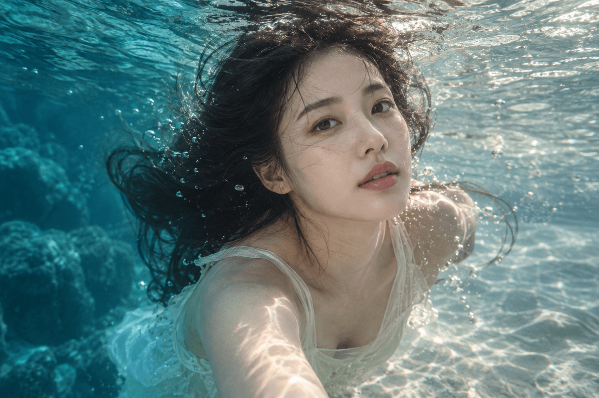

<p align="center"></p>

# STILLME - Different photo. Still you.

사진 한 장으로 **증명사진, 비즈니스 프로필, 개인 프로필** 등을 만들어 주는 AI 사진 생성 웹 서비스입니다.
AI가 만든 사진을 그대로 내보내지 않고, 원본과 같은 사람인지와 피부 표현이 유지됐는지 확인한 뒤 통과한 결과만 제공합니다.

- 상태: 운영 환경 배포 완료, 실사용자 유입 전 (개발 기간 2026.07.25 ~ 2026.09.29)
- 서비스: https://stillme-photo.vercel.app
- 개발 방식: Codex를 활용한 1인 개인 프로젝트

| 증명사진 | 비즈니스 프로필 | 개인 프로필 | 수중 사진 보정 |
|---|---|---|---|
|  |  |  |  |

<sub>서비스 소개 화면에 사용하는 예시 이미지입니다.</sub>

## 주요 기능

- **5가지 사진 서비스**: 증명사진, 직업별 비즈니스 프로필, 개인 프로필, 캐릭터 프로필, 수중 사진 색감과 조명 보정
- **생성 결과 자동 검증**: 얼굴 유사도(AWS Rekognition)와 피부 표현(Gemini)을 점수로 확인
- **제한된 재생성**: 기준에 못 미치면 실패 이유에 맞게 지침을 보강해 다시 생성 (요청 전체에서 최대 2회 추가)
- **크레딧 결제**: 그로블 결제, 생성에 실패하면 예약한 크레딧 복원
- **안전한 이미지 보관**: 비공개 저장소(Cloudflare R2), 로그인과 소유권을 확인한 뒤 다운로드

## 직접 담당한 개선

- **UI/UX 전체 개편**: 모델명과 프롬프트를 직접 입력하던 개발자용 화면을, 서비스 선택 → 사진 업로드 → 옵션 선택 순서의 사용자 화면으로 바꿨습니다.
- **프롬프트 개선과 결과 검수**: 생성된 사진을 원본과 비교하며 프롬프트를 고쳤습니다. 원본에 없던 점이나 여드름이 생기던 문제가 개선 후 직접 확인한 사진에서는 거의 나타나지 않았습니다. (직접 검수한 사진에서 본 변화이며, 전체 요청 기준의 개선율은 아닙니다.)
- **검증과 재생성 방식 제안**: 이상한 결과를 그대로 내보내지 않도록 다시 검사하고 최대 두 번 더 생성하는 방식을 제안해, AI 코딩 도구로 서비스에 반영했습니다.

코드 구현은 Codex와 Claude Code로 했고, 기획과 화면 구성, 프롬프트, 결과 검수는 직접 맡았습니다.

## 백엔드 아키텍처

별도 서버 없이 Next.js App Router의 **Server Action**(생성 요청, 인증, 크레딧 예약)과 **Route Handler**(다운로드 API)를 백엔드로 사용합니다.
주요 진입점: [`src/app/generate/actions.ts`](src/app/generate/actions.ts)

### 기술 스택

| 영역 | 사용 기술 |
|---|---|
| 웹, 백엔드 | Next.js 15 App Router, React 19, TypeScript, Tailwind CSS |
| 인증, DB | Supabase Auth, Supabase PostgreSQL (RLS) |
| AI | Google AI Image API (이미지 생성), Gemini (피부 평가), AWS Rekognition (얼굴 비교) |
| 저장, 결제 | Cloudflare R2 비공개 버킷, 그로블 |
| 배포, 도구 | Vercel, GitHub Actions, Codex, Claude Code |

## 이미지 생성과 검증 흐름

```
입력 검사 (로그인, 옵션, 파일 형식과 크기, 크레딧)
 → 크레딧 예약
 → 후보 이미지 생성
 → 파일 구조 검사 (형식, 크기, 비율, 손상 여부)
 → 얼굴 유사도 검사 (AWS Rekognition, 0.90 이상)
 → 피부 표현 검사 (Gemini, 0.72 이상)
 → 통과한 후보 3장 확보 → R2 저장 → 크레딧 사용 확정

 기준 미달: 실패 이유에 맞는 지침을 더해 다시 생성
 끝내 실패: 결과를 주지 않고 크레딧 예약 해제
```

설계 원칙: **AI는 점수만 내고, 통과 여부는 서버가 정한다.**

얼굴 유사도에서 떨어진 결과는 피부 검사를 건너뛰어, 어차피 버릴 결과에 평가 API를 쓰지 않습니다.

관련 코드: [`image-quality.ts`](src/lib/generation/image-quality.ts), [`aws-face-validator.ts`](src/lib/generation/aws-face-validator.ts), [`google-skin-validator.ts`](src/lib/generation/google-skin-validator.ts), [`semantic-validation.ts`](src/lib/generation/semantic-validation.ts)

## 서비스별 검증 전략

모든 서비스에 같은 기준을 쓰지 않고, 서비스 목적에 맞게 평가합니다.

| 서비스 | 평가 방식 |
|---|---|
| 증명사진, 비즈니스 프로필, 개인 프로필 | AWS 얼굴 유사도 검사 후 Gemini 피부 평가 |
| 수중 사진 보정 | 피사체와 장면 구조 보존, 수중 색감 복원 평가 (얼굴 검사 강제하지 않음) |
| 캐릭터 프로필 | 인물 특징 보존과 선택한 캐릭터 스타일 충족 여부 평가 |

## 제한된 재생성과 비용 통제

- 목표: 검증을 통과한 후보 3장
- 이미지 생성 호출은 요청 전체에서 최대 5회 (추가 생성 여유 2회, 후보마다 2회가 아님)
- 얼굴이 달라지면 동일인 보존 지침을, 피부가 달라지면 피부 특징 보존 지침을 더해 다시 생성
- 끝내 3장을 채우지 못하면 일부 결과도 주지 않고 크레딧 예약을 해제

## 검증 실패 처리

검증을 끝내지 못한 결과는 통과로 보지 않습니다(**Fail-closed**).
평가 API 오류, 점수 누락, 0~1 범위를 벗어난 점수, 응답 형식 오류, 이미지 형식 불일치는 모두 실패로 처리합니다.

얼굴 0.90, 피부 0.72는 서버가 결과를 받아들이는 기준값이며, 모델의 정확도나 품질 개선율을 뜻하지 않습니다.

## 크레딧 처리

```
크레딧 예약 → 생성과 검증 → 성공: 사용 확정 / 실패: 예약 해제
```

같은 요청이 반복돼도 두 번 차감되지 않도록 요청 식별자와 DB 함수(RPC)로 처리합니다.
관련 코드: [`src/lib/credits/`](src/lib/credits/)

## 데이터베이스 구조

Supabase PostgreSQL에 사용자 프로필, 크레딧 원장과 예약, 결제 주문, 생성 작업, 이미지 Asset을 저장합니다.
생성 작업에는 프롬프트 ID와 버전, 모델 정보, 상태와 실패 코드를 남기고, 프롬프트 원문이나 이미지 base64는 저장하지 않습니다.

## 이미지 저장과 다운로드

검증을 통과한 이미지만 Cloudflare R2 비공개 버킷에 올리고, 체크섬을 확인한 뒤 DB 상태를 갱신합니다.
다운로드할 때는 로그인과 이미지 소유권을 확인합니다.

관련 코드: [`src/lib/storage/`](src/lib/storage/), [`다운로드 Route Handler`](src/app/api/assets/[assetId]/download/route.ts)

## 오류 처리와 개인정보 보호

- 외부 API의 원문 오류 대신 정리된 한국어 안내 메시지를 보여줍니다.
- API 키와 비밀키는 서버 환경변수에서만 사용합니다.
- 이미지 base64, 전체 프롬프트, Provider 원문 응답은 로그에 남기지 않습니다.
- AWS 평가용 이미지는 최대 1,600px JPEG로 줄여서 보냅니다.

## 프로젝트 구조

```
src/
  app/
    generate/     생성 요청 처리 (Server Action)
    api/          다운로드 등 API
  lib/
    generation/   이미지 생성과 평가 파이프라인
    prompts/      서비스별 프롬프트
    storage/      R2 저장과 이미지 접근
    credits/      크레딧 원장과 예약
    payments/     결제
components/       공통 UI
supabase/         DB migration
tests/            통합, E2E 테스트
```

## 로컬 실행

```bash
npm install
cp .env.example .env.local     # 개발용 설정 입력 (실제 키는 커밋하지 않음)

npm run supabase:start         # 로컬 DB (Docker 필요)
npm run supabase:reset         # 로컬 DB 초기화
npm run dev                    # http://localhost:3001
```

## 저장소 검사 명령

```bash
npm run docs:check && npm run typecheck && npm run lint && npm run build
npm run test                   # 단위 테스트
npm run test:db                # DB 테스트
npm run test:integration       # 통합 테스트
```

## 관련 문서

- [문서 안내](docs/00_HOME.md), [개발 규칙](CODEX.md), [프로젝트 계획](MASTER_PLAN.md), [변경 기록](CHANGELOG.md)
- 포트폴리오: [STILLME 소개 (Notion)](https://goofy-interest-b99.notion.site/STILLME-Different-photo-Still-you-3cd6b4887d9180799ccfc7ec26e6c99b)

## 라이선스

All rights reserved. 포트폴리오 열람 목적으로 공개한 저장소이며, 자세한 내용은 [LICENSE](LICENSE)를 참고하세요.
