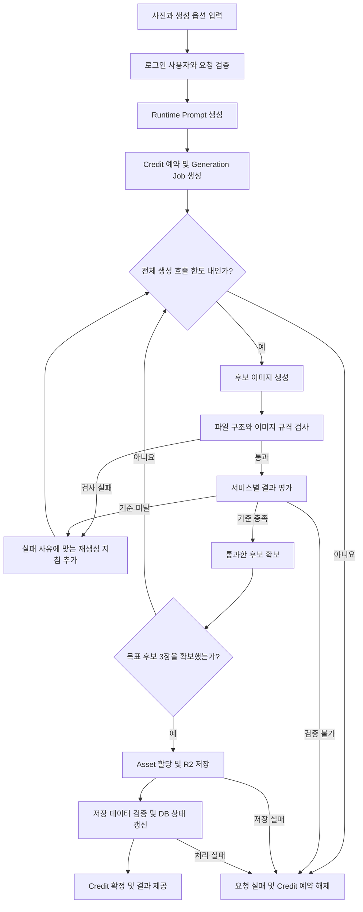

# STILLME

**Different photo. Still you.**

사진 한 장으로 증명사진과 프로필 사진 등을 만드는 AI 사진 생성 서비스입니다.

이미지를 생성하는 데서 끝내지 않고, 원본 인물과의 유사도와 피부 표현을 평가합니다. 기준을 통과하지 못한 결과는 제한된 횟수 안에서 다시 생성하며, 결과 제공에 실패하면 예약한 크레딧을 복원합니다.

- 프로젝트 기간: 2026.07.25 ~ 2026.09.29
- 개발 상태: 프로젝트 개발 종료, 운영 환경 배포 완료
- 서비스: https://stillme-photo.vercel.app
- 개발 방식: Codex와 Claude Code를 활용한 개인 프로젝트

## 주요 기능

- 증명사진 생성
- 직업별 비즈니스 프로필 생성
- 개인 프로필 생성
- 수중 사진 색감과 조명 보정
- 캐릭터 프로필 생성
- 생성 결과의 얼굴 유사도와 피부 표현 검증
- 검증 실패 사유에 따른 제한적 재생성
- 회원 인증과 이미지 소유권 확인
- 그로블 결제와 크레딧 관리
- Private Storage 기반 이미지 저장과 다운로드

## 직접 담당한 개선

### 전체 UI/UX 개편

개발자 중심의 프롬프트 입력 화면을 사진 결과 중심의 서비스 흐름으로 변경했습니다.

사용자는 모델명이나 프롬프트를 직접 다루는 대신, 원하는 사진 서비스를 선택하고 사진을 업로드한 뒤 필요한 옵션을 설정해 결과를 생성합니다.

### 프롬프트 개선과 사진 검수

생성된 사진을 원본과 비교하며 프롬프트를 꾸준히 개선했습니다.

초기에는 원본에 없던 점이나 여드름이 생기는 경우가 있었습니다. 개선 후 직접 확인한 사진에서는 이런 문제가 거의 나타나지 않았습니다. 이는 직접 검수한 결과에서 관찰한 변화이며, 전체 요청에 대한 품질 개선율을 의미하지 않습니다.

### 검증과 추가 생성 방식 제안

이상한 결과를 그대로 제공하지 않도록 재검사를 거쳐 이미지를 최대 두 번 더 생성하는 방식을 제안하고, AI 코딩 도구를 활용해 서비스에 반영했습니다.

서비스에는 파일 구조 검사, 얼굴 유사도 검사, 피부 표현 평가와 실패 사유에 따른 보충 생성 흐름이 적용되어 있습니다. 구현된 기능의 상세 구조는 아래에 설명합니다.

### AI 도구 활용

코드 구현에는 Codex와 Claude Code를 활용했습니다. 서비스 기획, 전체 UI/UX 개편, 프롬프트 개선과 생성 사진 검수는 직접 담당했습니다.

## 백엔드 아키텍처

별도의 Express나 NestJS 서버 없이 **Next.js App Router의 Server Action과 Route Handler**를 백엔드로 사용했습니다.

Server Action에서 인증, 요청 검증, 프롬프트 생성, 크레딧 예약과 이미지 생성 작업을 처리합니다. Route Handler에서는 이미지 다운로드 등 API 요청을 처리합니다.

주요 생성 요청 진입점:

[`src/app/generate/actions.ts`](src/app/generate/actions.ts)

### 기술 스택

| 구분 | 기술 |
|---|---|
| 웹 애플리케이션과 백엔드 | Next.js 15 App Router, React 19 |
| 언어 | TypeScript |
| 스타일 | Tailwind CSS |
| 인증 | Supabase Auth |
| 데이터베이스 | Supabase PostgreSQL |
| DB 접근 제어 | RLS, 서버 전용 Admin Client |
| 이미지 생성 | Google AI Image API |
| 얼굴 평가 | AWS Rekognition |
| 피부 평가 | Gemini |
| 이미지 저장 | Cloudflare R2 Private Bucket |
| 결제 | 그로블 |
| 사용량 관리 | Credit Ledger |
| 배포 | Vercel |
| AI 코딩 도구 | Codex, Claude Code |

## 이미지 생성과 검증 흐름

아래는 생성 요청의 개념적인 처리 흐름입니다. 결과 평가 방식은 서비스에 따라 달라집니다.



### 1. 요청 검증

이미지 생성 전에 다음을 확인합니다.

- 로그인 사용자
- 선택한 서비스와 생성 옵션
- 업로드 파일의 형식과 크기
- 요청에 필요한 입력값
- 사용 가능한 크레딧

API Key, R2 credential과 Supabase service key는 서버에서만 사용합니다.

### 2. 기술적 이미지 품질 검사

AI가 반환한 결과를 바로 저장하지 않고 파일 구조와 이미지 규격을 먼저 검사합니다.

주요 검사 항목:

- JPEG, PNG, WebP 파일 시그니처
- 선언된 MIME type과 실제 이미지 형식의 일치 여부
- 이미지 크기와 픽셀 수
- 요청한 화면 비율
- 손상된 이미지 데이터
- 허용하지 않는 메타데이터

구조가 잘못된 결과는 얼굴이나 피부 검사로 넘기지 않습니다.

관련 코드:

- [`image-quality.ts`](src/lib/generation/image-quality.ts)
- [`image-dimensions.ts`](src/lib/generation/image-dimensions.ts)

### 3. 얼굴 유사도 검사

실사 인물 사진은 AWS Rekognition의 `CompareFaces`로 원본과 생성 사진의 얼굴 유사도를 확인합니다.

| 항목 | 내용 |
|---|---|
| 평가 기술 | AWS Rekognition CompareFaces |
| 서버 통과 기준 | 0.90 이상 |
| 기준 미달 | 결과 거절 및 보충 생성 대상 처리 |

얼굴 유사도가 기준에 미치지 못하면 피부 검사를 실행하지 않습니다. 이미 거절할 결과에 추가 평가 API 호출을 사용하지 않도록 구성했습니다.

관련 코드:

- [`aws-face-validator.ts`](src/lib/generation/aws-face-validator.ts)
- [`semantic-validation.ts`](src/lib/generation/semantic-validation.ts)

### 4. 피부 표현 검사

얼굴 유사도를 통과한 결과는 Gemini 기반 피부 평가 단계로 전달합니다.

| 항목 | 내용 |
|---|---|
| 평가 기술 | Gemini |
| 서버 통과 기준 | 0.72 이상 |
| 평가 대상 | 원본 피부 특징 보존과 인위적인 표현 여부 |
| 기준 미달 | 결과 거절 및 보충 생성 대상 처리 |

평가에서는 다음과 같은 문제를 확인합니다.

- 원본에 없던 점, 여드름, 흉터나 반점 생성
- 원본의 뚜렷한 점이나 모반 삭제 또는 이동
- 원본과 다른 피부색
- 플라스틱처럼 지나치게 매끄러운 피부 표현

모델이 반환한 통과 여부를 그대로 사용하는 대신, 서버에서 점수의 유효성을 확인하고 기준값으로 최종 판단합니다.

관련 코드:

- [`google-skin-validator.ts`](src/lib/generation/google-skin-validator.ts)
- [`semantic-validation.ts`](src/lib/generation/semantic-validation.ts)

## 서비스별 검증 전략

모든 서비스에 얼굴 유사도와 피부 점수를 동일하게 적용하지 않습니다.

| 서비스 | 평가 방식 |
|---|---|
| 증명사진, 비즈니스 프로필, 개인 프로필 | AWS 얼굴 유사도 검사 후 Gemini 피부 평가 |
| 수중 사진 보정 | 피사체와 장면 구조 보존, 수중 색감 복원 평가 |
| 캐릭터 프로필 | 인물 특징 보존과 선택한 캐릭터 스타일 충족 여부 평가 |

얼굴이 반드시 존재하지 않는 수중 사진에는 AWS 얼굴 검사를 강제하지 않습니다. 각 서비스 목적에 맞는 별도 평가 기준을 사용합니다.

## 제한된 재생성과 비용 통제

무제한 재시도 대신 전체 이미지 생성 호출 횟수에 상한을 둡니다.

- 목표 결과: 검증을 통과한 후보 이미지 3장
- 전체 이미지 생성 호출 상한: 최대 5회
- 보충 생성 대상: 검증을 통과하지 못한 후보
- 보충 생성 방식: 실패 사유에 맞는 지침을 기존 프롬프트에 추가
- 최종 실패: 부분 결과를 제공하지 않고 크레딧 예약 해제

추가 생성 여유는 전체 요청에서 최대 두 번입니다. 후보마다 두 번씩 재시도하는 방식은 아닙니다.

얼굴 유사도가 부족하면 동일인 보존 지침을, 피부 평가가 기준에 미치지 못하면 원본 피부 특징 보존 지침을 보강합니다. 추가 생성된 결과도 같은 검증 과정을 거칩니다.

관련 코드:

- [`actions.ts`](src/app/generate/actions.ts)
- [`semantic-validation.ts`](src/lib/generation/semantic-validation.ts)

## 검증 실패 처리

검증을 완료할 수 없는 결과를 정상 통과로 간주하지 않는 **Fail-closed 정책**을 사용합니다.

다음 상황은 통과 결과로 처리하지 않습니다.

- 평가 API 오류가 복구되지 않은 경우
- 평가 점수 누락
- NaN, 무한대 또는 0~1 범위를 벗어난 점수
- 평가 응답 형식 오류
- 이미지 형식과 실제 데이터 불일치
- 생성 호출 한도 안에서 목표 결과를 확보하지 못한 경우

정상적인 기준 미달과 평가 시스템 오류를 구분하되, 어느 경우든 검증되지 않은 결과를 사용자에게 제공하지 않습니다.

### 검증 기준의 의미

얼굴 유사도 0.90과 피부 평가 점수 0.72는 서버에서 결과를 허용하기 위한 기준입니다.

이 값은 AWS Rekognition이나 Gemini의 절대 정확도, 사용자 만족도 또는 서비스 품질 개선율을 의미하지 않습니다.

## 크레딧 처리

크레딧은 단순한 잔액 변경이 아니라 원장과 예약 상태를 기반으로 관리합니다.

```text
Credit 예약
    ↓
이미지 생성 및 검증
    ├─ 전체 성공 → 예약 Credit 사용 확정
    └─ 실패 → 예약 해제 및 Credit 복원
```

동일 요청이 반복되어도 중복 차감되지 않도록 요청 식별자와 DB RPC를 사용합니다. 크레딧과 생성 작업 상태는 DB 함수에서 원자적으로 처리합니다.

그로블 결제로 구매한 크레딧은 이미지 생성 요청의 예약과 사용 확정 흐름에 연결됩니다.

관련 코드:

[`src/lib/credits/`](src/lib/credits/)

## 데이터베이스 구조

Supabase PostgreSQL에는 다음 정보를 관리합니다.

- 사용자 프로필
- 크레딧 원장과 예약
- 결제 주문
- 이미지 생성 작업
- 생성된 이미지 Asset
- Prompt ID와 version
- Model 정보
- 생성 상태와 실패 코드
- 저장소 object key

생성 작업과 이미지 정보를 분리해 관리합니다.

```text
생성 작업
├── 요청 사용자와 선택 서비스
├── Prompt ID와 version
├── Model 정보
├── 처리 상태와 실패 코드
└── 생성 시간

이미지 Asset
├── 연결된 생성 작업
├── 소유 사용자
├── Storage object key
├── MIME type
├── 이미지 크기
├── Checksum
└── 처리 상태
```

전체 프롬프트 원문이나 이미지 base64 대신, 추적에 필요한 식별자와 버전 정보를 저장합니다.

## 이미지 저장과 다운로드

생성 결과는 검증을 통과한 뒤 저장하고 공개합니다.

```text
이미지 검증 완료
    ↓
Asset 할당
    ↓
Cloudflare R2 업로드
    ↓
Checksum과 저장 데이터 검증
    ↓
DB 상태 갱신
    ↓
사용자에게 결과 제공
```

Cloudflare R2는 Private Bucket으로 사용합니다. 다운로드 요청이 들어오면 Next.js API에서 로그인과 이미지 소유권을 확인한 뒤 결과를 반환합니다.

관련 코드:

- [`src/lib/storage/`](src/lib/storage/)
- [`다운로드 Route Handler`](src/app/api/assets/[assetId]/download/route.ts)

## 오류 처리와 개인정보 보호

외부 API의 원문 오류를 그대로 사용자에게 보여주지 않습니다.

내부에서는 잘못된 요청, API 인증 실패, 모델 접근 오류, 호출 한도 초과, Provider 장애, 안전 정책 거부와 응답 이미지 오류 등을 구분합니다. 사용자에게는 정리된 한국어 안내 메시지를 전달합니다.

보안과 로그 처리 원칙:

- API Key와 비밀키는 서버 환경변수에서만 사용
- 원본과 생성 이미지의 base64를 로그에 기록하지 않음
- 전체 프롬프트와 Provider 원문 응답을 로그에 기록하지 않음
- 실패 코드와 처리 단계 등 제한된 진단 정보만 기록
- AWS 평가용 이미지는 최대 1,600px JPEG로 정규화
- 이미지 저장소는 비공개로 유지
- 다운로드 시 사용자 인증과 소유권 확인

## 프로젝트 구조

```text
components/                   공통 UI 컴포넌트

src/
├── app/                      Next.js 화면, Server Action, Route Handler
│   ├── generate/             생성 요청 처리
│   └── api/                  다운로드 등 API
└── lib/
    ├── generation/           이미지 생성과 평가 파이프라인
    ├── prompts/              서비스별 Runtime Prompt
    ├── storage/              R2 저장과 이미지 접근 처리
    ├── credits/              Credit 원장과 예약 처리
    └── payments/             결제 처리

supabase/                     DB migration과 관련 설정
tests/                        통합 테스트와 E2E 테스트
scripts/                      저장소 검사와 자동화
docs/                         제품과 기술 문서
```

## 로컬 실행

### 설치와 환경변수 준비

```bash
npm install
cp .env.example .env.local
```

`.env.local`에 개발 환경의 설정을 입력합니다. 실제 비밀키는 저장소에 커밋하지 않습니다.

### 로컬 Supabase 사용

Docker 호환 런타임이 필요합니다.

```bash
npm run supabase:start
npm run supabase:reset
```

`supabase:reset`은 로컬 DB를 초기화하는 명령입니다. 시작 명령에서 안내하는 연결 정보를 `.env.local`에 반영합니다.

### 개발 서버 실행

```bash
npm run dev
```

기본 개발 서버:

http://localhost:3001

## 저장소 검사 명령

다음은 저장소의 문서, 타입, 코드와 빌드를 검사하는 명령입니다.

```bash
npm run docs:check
npm run typecheck
npm run lint
npm run build
```

테스트 명령:

```bash
npm run test
npm run test:db
npm run test:integration
```

검사 명령 안내와 실제 실행 결과는 구분합니다. README에 미확인 통과 건수나 테스트 결과를 기재하지 않습니다.

## 관련 문서

- [문서 안내](docs/00_HOME.md)
- [개발 규칙](CODEX.md)
- [프로젝트 계획](MASTER_PLAN.md)
- [변경 기록](CHANGELOG.md)
