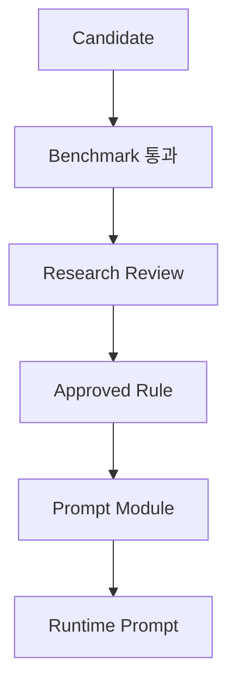

# Work005-002 승인 기준

## 1. 승격 절차

이번 Work는 `Candidate`와 실험 계획까지만 만든다. `Approved Rule`, Module 반영, Runtime Prompt 생성은 수행하지 않는다.

## 2. Benchmark 통과 기준

Rule이 Review 대상으로 넘어가려면 모두 만족해야 한다.

- Core와 Holdout에서 Hard Gate 통과율 100%
- 전체 평균 85/100 이상
- 동일 인물 유지 평균 4/5 이상, 개별 원본 최저 3/5 이상
- 얼굴 구조 유지 평균 4/5 이상
- 요청 외 변경 통제 평균 4/5 이상
- baseline 대비 Blind A/B 승률 60% 이상(동률 제외) 또는 사전 정의한 비열등 기준 충족
- 핵심 지표에서 원본 하위집단별 치명 회귀 없음
- 최소 2회 반복에서 한 번만 우연히 성공한 조건이 아님
- 모델·출력 설정·실패 사례·비용·지연 기록 완료

표본 수가 작아 통계적 결론이 불가능하면 `통과`가 아니라 `추가 실험`으로 판정한다.

## 3. Review 체크리스트

- 변경된 문구 외 조건이 실제로 동일했는가
- Rule 효과가 다른 Rule 또는 배치 순서의 효과와 섞이지 않았는가
- 목적과 무관한 미적 선호로 승자를 정하지 않았는가
- NB2와 Pro 결과를 혼합 평균하지 않았는가
- 공식 적합성·법률적 보장을 이미지 품질로 추론하지 않았는가
- 중복 Rule로 기존 책임을 늘리지 않고 canonical 표현으로 합칠 수 있는가
- 실패 조건, 비적용 범위, override 조건이 명시됐는가

## 4. 판정 유형

| 판정 | 의미 | 후속 조치 |
|---|---|---|
| Benchmark 통과 | 정해진 조건에서 효과 확인 | 사람 Review 요청 |
| 비열등·간소화 승리 | 품질 동일, 더 짧고 충돌 적음 | 짧은 canonical variant 검토 |
| 조건부 통과 | 특정 카테고리·모델에만 효과 | 적용 범위를 좁혀 Review |
| 추가 실험 | 효과 작음·분산 큼·표본 부족 | fixture 또는 반복 확대 |
| Reject | 효과 부족·치명 회귀·책임 중복 | rejected 제안, 근거 보존 |
| Archive | 과거 유효하나 현재 구조에서 불필요 | 이력만 유지 |

## 5. Prompt Engine 반영 통제

Review 승인 후에도 다음 절차가 필요하다.

1. Rule ID와 증거 bundle에 승인자·날짜·적용 범위를 기록한다.
2. 기존 Module 책임과 충돌·중복을 검토한다.
3. 모델 중립 Rule을 Module에 저장하고 NB2/Pro Compiler 표현은 분리한다.
4. Registry schema 및 단위 테스트를 통과한다.
5. Runtime 조립 snapshot과 회귀 Benchmark를 수행한다.
6. 단계적 배포와 rollback 기준을 둔다.

정책 Rule(R024)은 이미지 미학 점수가 아니라 올바른 차단·경고와 오탐률을 기준으로 별도 승인한다. R023은 Runtime Rule이 아닌 후처리 의사결정 대상으로 취급한다.

