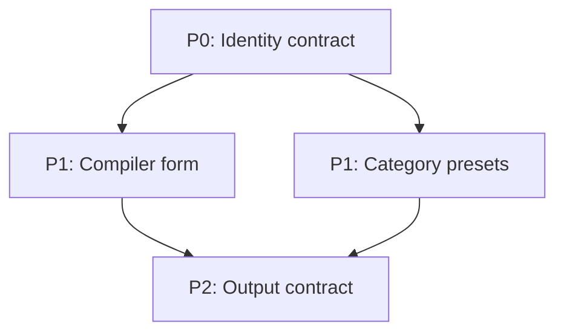

# Work005-002 실험 우선순위

## 우선순위 정의

- **P0**: 모든 Portrait Prompt의 신원·변경 통제를 결정하므로 가장 먼저 수행한다.
- **P1**: 카테고리 품질과 사진 자연스러움에 큰 영향을 주며 P0 승자 위에서 검증한다.
- **P2**: 출력 최적화, 정책, 범위 밖 합성 또는 후속 검증이다.

## 실행 순서

| 순서 | ID | 실험 | 우선순위 | 선정 이유 | 영향 Module |
|---:|---|---|---|---|---|
| 1 | EXP-001 | 동일인 보존 표현 비교 | P0 | 모든 인물 편집의 치명 실패를 직접 통제 | `core.identity`, `core.facial-geometry` |
| 2 | EXP-005 | Source of Truth | P0 | 어떤 입력이 기준인지 먼저 고정해야 나머지 실험 해석 가능 | `core.source-of-truth` |
| 3 | EXP-006 | Edit Boundary | P0 | 요청 외 변화가 있으면 스타일 점수가 왜곡됨 | `core.edit-boundary` |
| 4 | EXP-002 | 피부 보존 | P0 | 과미화·피부색 변화는 서비스 신뢰를 즉시 손상 | `core.skin-tone`, `core.retouch-intensity` |
| 5 | EXP-003 | 헤어 보존 | P0 | 헤어는 정체성 특징이며 grooming과 충돌 | `core.hair-preservation` |
| 6 | EXP-004 | 표정 보존 | P0 | 입·치아 변화가 신원과 자연스러움에 큰 영향 | `core.expression-baseline`, `category.expression-envelope` |
| 7 | EXP-009 | 긍정형/부정형 비교 | P1 | P0 Rule들의 canonical 표현을 정함 | Core 전반 Compiler |
| 8 | EXP-008 | 구성 순서 비교 | P1 | Source/identity/boundary의 우선 배치를 결정 | Prompt Compiler |
| 9 | EXP-007 | 프롬프트 길이 비교 | P1 | 중복 제거와 최소 충분 길이를 결정 | Prompt Compiler |
| 10 | EXP-016 | Pose/Gaze 분리 | P1 | 정면 성공률과 눈동자 이탈을 독립 통제 | `id.pose.head-orientation`, `id.gaze.target` |
| 11 | EXP-010 | 비즈니스 프로필 | P1 | 의상·배경·표정·조명 조합의 회귀를 확인 | `style.business`, `style.profile`, `category.wardrobe` |
| 12 | EXP-011 | 조명 | P1 | 얼굴 가독성과 합성 자연스러움에 직접 영향 | `id.lighting.even-soft`, `id.lighting.shadow-level` |
| 13 | EXP-012 | 구도 | P1 | 실제 사용 가능한 크롭·중앙 배치를 결정 | `id.composition.crop` |
| 14 | EXP-013 | 배경 | P1 | halo·잔존물·색상 정확성을 통제 | `category.background` |
| 15 | EXP-015 | Grooming Delta | P1 | 헤어 보존 승자에서 허용 정돈 범위를 좁힘 | `category.grooming-delta` |
| 16 | EXP-017 | Aspect Ratio Config | P2 | 공식 기능이므로 품질보다 전달 계층 최적화 문제 | `output.image-config.aspect-ratio` |
| 17 | EXP-014 | 출력 안전 | P2 | 품질 실험과 분리된 정책·오염 검증 | `output.exclusions`, `safety.brand-officiality` |

## 의존성

P0 실험의 승자 조합을 공통 고정조건으로 만든 뒤 P1을 진행한다. P2는 Prompt 품질 승인을 대체하지 않으며, 다중 참조·합성 R020~R022와 반복 레이아웃 R023은 별도 연구 트랙으로 이관한다.

